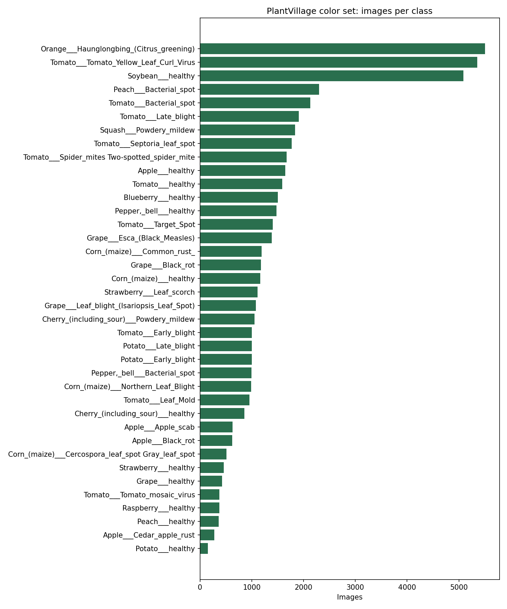
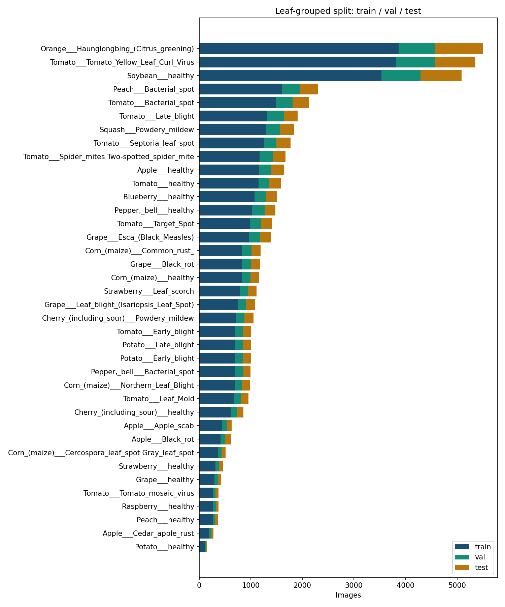
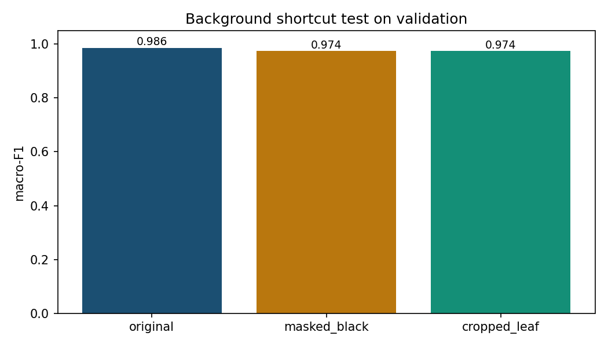

# Plant Leaf Disease Classifier with Transfer Learning

**Covers course P11**

Classify color photographs of plant leaves into healthy and disease classes using transfer learning, explainability, and a held-out test scored once.

Educational demo only — not for field diagnosis or agricultural advice.

## Problem

PlantVillage lab photos look clean and repeatable. A model that scores well there can still fail when the leaf sits on soil, under phone lighting, or when two diseases on the same crop look alike. This project trains and compares several CNNs on a leaf-grouped split, then checks Grad-CAM, background shortcuts, failure modes, and domain shift before locking the test score.

## Dataset

Source: [spMohanty/PlantVillage-Dataset](https://github.com/spMohanty/PlantVillage-Dataset). 54,305 color images, 38 classes, 14 crops. Cite Mohanty, Hughes, and Salathé, *Using Deep Learning for Image-Based Plant Disease Detection*, Frontiers in Plant Science, 2016.

Images are not committed. Download only `raw/color` plus the leaf-id map:

```bash
python data/download_plantvillage.py
python data/prepare_plant_split.py
```

Split: **70% train / 15% val / 15% test**, seed **42**. Photos of the same physical leaf stay in one split so near-duplicates cannot leak into test.





## Method

1. Scratch CNN baseline from random weights
2. ResNet-50: frozen → last-block → full fine-tune (discriminative LR)
3. EfficientNet-B0 and MobileNetV2 full fine-tune
4. Augmentation study on EfficientNet-B0
5. Grad-CAM / Grad-CAM++ / SmoothGrad on the best checkpoint
6. Background-mask shortcut test, 30-error taxonomy, own-leaf / field-style domain shift
7. Held-out test scored **once** and locked
8. Gradio demo with Grad-CAM overlay and disclaimer

## Results

### Backbone comparison (validation)

| run | accuracy | macro-F1 | top-3 | top-5 |
| --- | ---: | ---: | ---: | ---: |
| scratch_cnn | 0.900 | 0.868 | 0.982 | 0.993 |
| resnet50_frozen | 0.974 | 0.966 | 0.998 | 1.000 |
| resnet50_last_block | 0.985 | 0.978 | 0.999 | 1.000 |
| resnet50_full | 0.984 | 0.979 | 0.996 | 0.999 |
| efficientnet_b0 | 0.990 | 0.986 | 0.999 | 1.000 |
| mobilenet_v2 | 0.984 | 0.981 | 0.999 | 1.000 |

### Augmentation study (EfficientNet-B0, validation)

| augmentation | accuracy | macro-F1 |
| --- | ---: | ---: |
| **color_jitter** | 0.990 | **0.986** |
| none | 0.990 | 0.986 |
| flip | 0.990 | 0.986 |
| randaugment | 0.989 | 0.986 |
| flip_rotate | 0.987 | 0.981 |

Chosen checkpoint: `runs/aug_color_jitter/best.pt`.

### Locked held-out test

| split | accuracy | macro-F1 | top-3 | top-5 | n |
| --- | ---: | ---: | ---: | ---: | ---: |
| val | 0.990 | 0.986 | — | — | 7939 |
| **test (locked)** | **0.992** | **0.987** | **1.000** | **1.000** | 8234 |

Do not retune on this split. Re-running `scripts/run_final_test.py` refuses unless `--force` is passed.

### Shortcut, errors, domain shift

| check | finding |
| --- | --- |
| Background shortcut | Mask/crop drops val macro-F1 by ~0.012 → mostly leaf-focused |
| Failure taxonomy (top-30) | 24/30 are same-crop disease confusions |
| Field-style proxies | macro-F1 0.986 → 0.889 (−0.097) |




## Why this model won

EfficientNet-B0 with light **color jitter** beat the scratch CNN by a large margin and edged out ResNet-50 full fine-tune and MobileNetV2 on validation macro-F1 while staying smaller than ResNet-50. Color jitter helped more than aggressive RandAugment or heavy rotation on this already clean lab set. Last-block ResNet fine-tuning was almost as strong as full fine-tuning, so freezing early layers was enough once ImageNet features were useful.

## What I learned

- **Freeze vs fine-tune:** a frozen ResNet head already reaches ~0.97 macro-F1; unfreezing the last block closes most of the remaining gap without needing a full backbone update.
- **Grad-CAM measures attention, not truth:** overlays show where the gradient flows for the predicted class. Useful for spotting background focus, not a proof of biological correctness.
- **PlantVillage background shortcuts are mild here:** removing the grey lab backdrop barely hurts, unlike the larger field-style drop from outdoor backdrops and phone JPEG/lighting.
- **Errors are mostly intra-crop:** corn Northern Leaf Blight ↔ Gray leaf spot and tomato look-alikes dominate, not random cross-crop mistakes.
- **Lab score ≠ phone score:** domain shift is the honest stress test for a course demo.

## Setup

```bash
python -m venv .venv
.venv\Scripts\activate
pip install -r requirements.txt
```

## How to run

```bash
# Data
python data/download_plantvillage.py
python data/prepare_plant_split.py

# Train / compare (examples)
python -m src.train
python -m src.train --config configs/resnet50_frozen.yaml
python -m src.train --config configs/efficientnet_b0.yaml
python -m src.train --config configs/aug_color_jitter.yaml

# Analysis
python scripts/generate_xai_grids.py
python scripts/run_shortcut_test.py
python scripts/run_error_analysis.py
python scripts/prepare_own_leaves_proxy.py
python scripts/run_domain_shift.py

# Locked test (once)
python scripts/run_final_test.py

# Demo
python -m app.main
```

Open http://127.0.0.1:7860 for the Gradio UI (class + confidence + Grad-CAM).

Put real phone photos in `data/own_leaves/` with `labels.csv` to replace the field-style proxies.

## Project layout

```text
app/                 Gradio demo
configs/             training configs
data/                download, split, own_leaves
reports/figures/     plots used above
reports/tables/      metric tables and locks
runs/                checkpoints
scripts/             analysis helpers
src/                 dataset, models, train, xai, metrics
tests/               pytest
```

## Limitations

- Trained on PlantVillage lab photos; field phones, new crops, and mixed diseases are out of distribution.
- Own-leaf numbers currently use synthetic field-style proxies unless you add real labeled photos.
- Grad-CAM can highlight healthy tissue or edges when the model is wrong.
- 38-way labels assume a single disease class per image.
- Not a farm decision tool and not a medical device.

## Tests

```bash
python -m pytest -q
```

Covers split helpers, model shapes/freeze rules, transforms, metrics vs scikit-learn, Grad-CAM plumbing, background masks, error taxonomy heuristics, domain-shift helpers, held-out test lock, and Gradio text/disclaimer helpers.

## License

See [LICENSE](LICENSE). PlantVillage data remains under its upstream terms.
