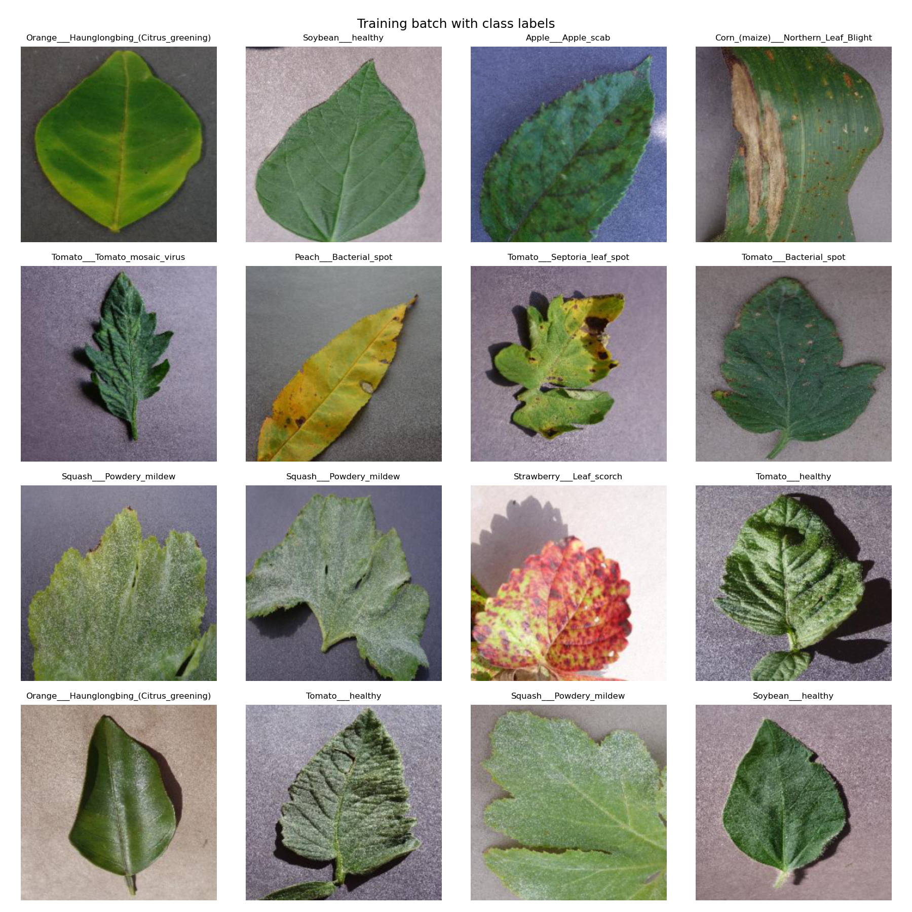
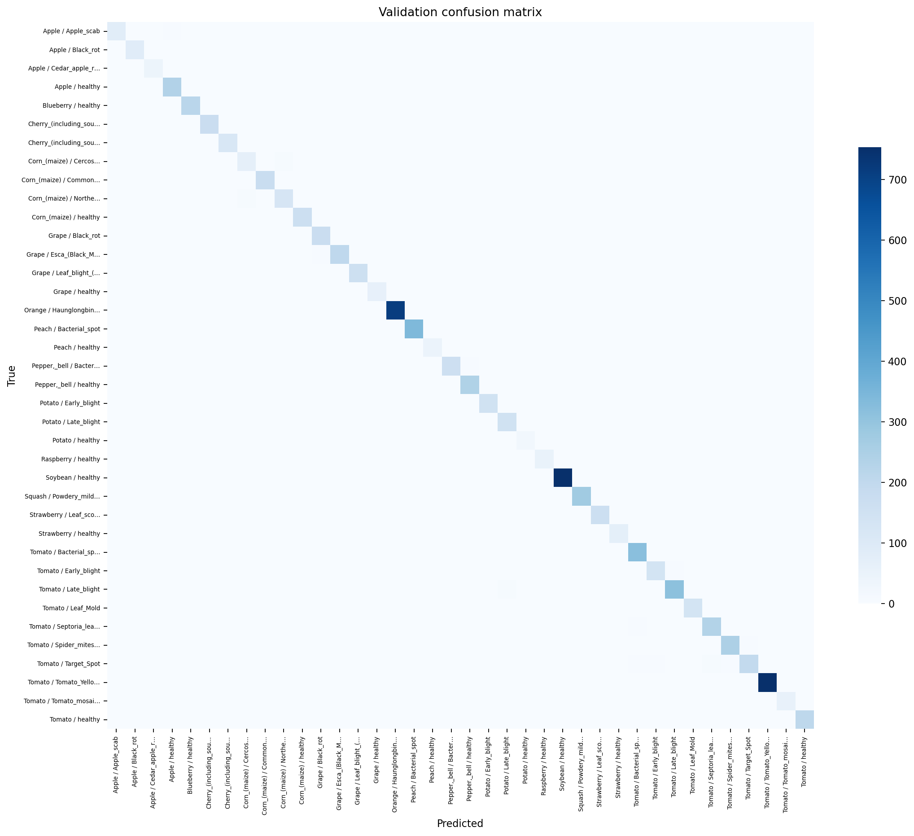
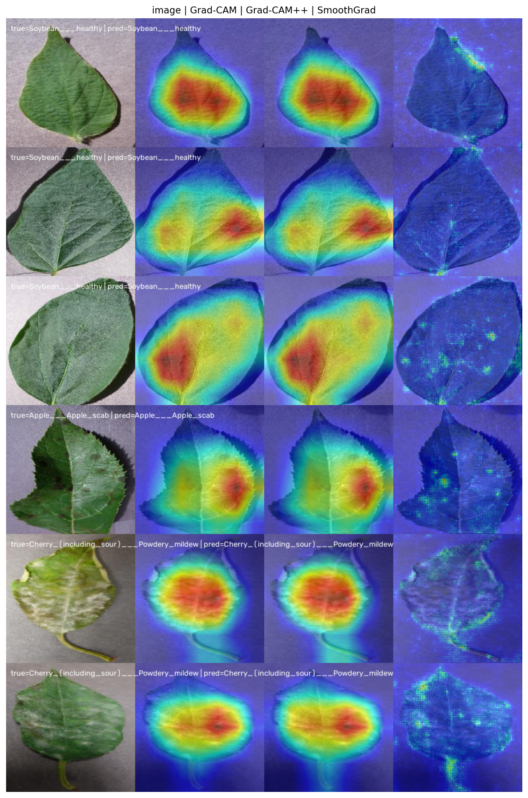
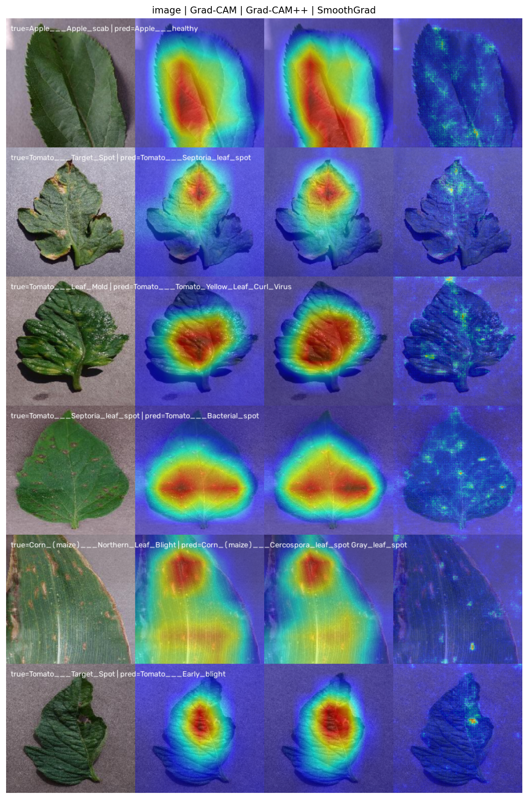
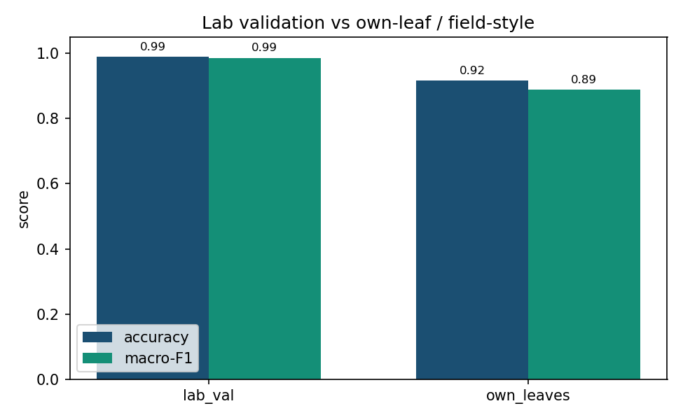

# Plant Leaf Disease Classifier

**Course P11 · Computer Vision · Transfer Learning + Explainability**

Upload a leaf photo → get a disease class, confidence, and a Grad-CAM overlay that shows *where* the model looked.

> Educational demo only — **not** for field diagnosis or agricultural advice.

---

## Overview

This project trains and audits CNN classifiers on [PlantVillage](https://github.com/spMohanty/PlantVillage-Dataset) color leaf photos (38 classes, 14 crops). The goal is not only a high lab score, but an honest pipeline:

| Stage | What we did |
| --- | --- |
| **Data** | Leaf-grouped 70 / 15 / 15 split so the same physical leaf never leaks into test |
| **Models** | Scratch CNN → ResNet-50 (freeze / last-block / full) → EfficientNet-B0 & MobileNetV2 |
| **Augmentation** | Controlled study on EfficientNet-B0; **color jitter** won |
| **Explain** | Grad-CAM / Grad-CAM++ / SmoothGrad on correct vs wrong cases |
| **Stress** | Background shortcut test, 30-error taxonomy, field-style domain shift |
| **Lock** | Held-out test scored **once** — no retuning on test |
| **Ship** | Gradio app with Grad-CAM, optional leaf crop, and uncertainty flags |

**Best model:** EfficientNet-B0 + color jitter → locked test **accuracy 0.992 · macro-F1 0.987**.

---

## Highlights

| | |
| --- | --- |
| **Dataset** | PlantVillage `raw/color` · 54,305 images · 38 classes |
| **Split** | 70% train / 15% val / 15% test · seed 42 · leaf-id grouped |
| **Winner** | `runs/aug_color_jitter/best.pt` |
| **Locked test** | Acc **0.992** · macro-F1 **0.987** · top-3/5 **1.000** · *n* = 8,234 |
| **Demo** | `python -m app.main` → http://127.0.0.1:7860 |

---

## Results at a glance

### Backbone comparison (validation)

| Run | Accuracy | Macro-F1 | Top-3 | Top-5 |
| --- | ---: | ---: | ---: | ---: |
| Scratch CNN | 0.900 | 0.868 | 0.982 | 0.993 |
| ResNet-50 frozen | 0.974 | 0.966 | 0.998 | 1.000 |
| ResNet-50 last block | 0.985 | 0.978 | 0.999 | 1.000 |
| ResNet-50 full | 0.984 | 0.979 | 0.996 | 0.999 |
| **EfficientNet-B0** | **0.990** | **0.986** | **0.999** | **1.000** |
| MobileNetV2 | 0.984 | 0.981 | 0.999 | 1.000 |

### Augmentation study (EfficientNet-B0, validation)

| Augmentation | Accuracy | Macro-F1 |
| --- | ---: | ---: |
| **color_jitter** ★ | 0.990 | **0.986** |
| none | 0.990 | 0.986 |
| flip | 0.990 | 0.986 |
| randaugment | 0.989 | 0.986 |
| flip_rotate | 0.987 | 0.981 |

### Locked held-out test

| Split | Accuracy | Macro-F1 | Top-3 | Top-5 | *n* |
| --- | ---: | ---: | ---: | ---: | ---: |
| Val | 0.990 | 0.986 | — | — | 7,939 |
| **Test (locked)** | **0.992** | **0.987** | **1.000** | **1.000** | **8,234** |

Re-running `scripts/run_final_test.py` refuses unless you pass `--force`.

### Audits beyond accuracy

| Check | Finding |
| --- | --- |
| Background shortcut | Mask/crop drops val macro-F1 by ~0.012 → mostly leaf-focused |
| Failure taxonomy (top-30) | 24/30 are same-crop disease confusions |
| Field-style proxies | macro-F1 0.986 → 0.889 (−0.097) |

---

## Figures

<p align="center">
  
  <br/><em>Sample training batch</em>
</p>

<p align="center">
  
  <br/><em>Validation confusion matrix</em>
</p>

<p align="center">
  
  
  <br/><em>Grad-CAM on correct (left) vs wrong (right) predictions</em>
</p>

<p align="center">
  
  
  <br/><em>Background shortcut · Domain-shift drop</em>
</p>

---

## Why this model won

EfficientNet-B0 with light **color jitter** beat the scratch CNN by a large margin and edged ResNet-50 / MobileNetV2 on validation macro-F1 while staying smaller than ResNet-50. On this clean lab set, mild color jitter helped more than aggressive RandAugment or heavy rotation. Last-block ResNet fine-tuning was nearly as strong as full fine-tuning — early ImageNet features were already useful.

---

## What the pipeline taught

- **Freeze vs fine-tune** — a frozen ResNet head already reaches ~0.97 macro-F1; unfreezing the last block closes most of the gap.
- **Grad-CAM ≠ truth** — overlays show gradient focus for the *predicted* class, not biological proof.
- **Lab shortcuts are mild here** — grey backdrop removal barely hurts; outdoor phones hurt a lot more.
- **Errors are intra-crop** — corn blight ↔ gray leaf spot and tomato look-alikes dominate, not random cross-crop mistakes.
- **Lab score ≠ phone score** — domain shift is the honest stress test for a course demo.

---

## Demo (Gradio)

```bash
python -m app.main
```

Open **http://127.0.0.1:7860**.

The app returns:

- Top-1 label + confidence  
- Top-5 alternatives  
- Grad-CAM overlay  
- Optional leaf crop preprocess  
- Uncertainty flag when confidence / margin is weak  

Public temporary link (laptop must stay on):

```bash
python -m app.main --share
```

Hugging Face model weights (if pushed): `tanvir-pr/plant-leaf-disease`. A free always-on Gradio Space usually needs **ZeroGPU** (or PRO for CPU Spaces).

---

## Setup

```bash
python -m venv .venv
.venv\Scripts\activate          # Windows
# source .venv/bin/activate     # macOS / Linux

pip install -r requirements.txt
```

### Data (not committed)

```bash
python data/download_plantvillage.py   # raw/color + leaf-id map
python data/prepare_plant_split.py     # leaf-grouped 70/15/15
```

Source: [spMohanty/PlantVillage-Dataset](https://github.com/spMohanty/PlantVillage-Dataset).  
Cite: Mohanty, Hughes & Salathé, *Using Deep Learning for Image-Based Plant Disease Detection*, Frontiers in Plant Science, 2016.

---

## How to reproduce

```bash
# Train / compare
python -m src.train --config configs/resnet50_frozen.yaml
python -m src.train --config configs/efficientnet_b0.yaml
python -m src.train --config configs/aug_color_jitter.yaml

# Explainability & audits
python scripts/generate_xai_grids.py
python scripts/run_shortcut_test.py
python scripts/run_error_analysis.py
python scripts/prepare_own_leaves_proxy.py
python scripts/run_domain_shift.py

# Locked test (once)
python scripts/run_final_test.py

# Demo
python -m app.main
```

Put real phone photos in `data/own_leaves/` with `labels.csv` to replace field-style proxies.

```bash
python -m pytest -q
```

---

## Project layout

```text
Project2/
├── app/                  # Gradio demo + inference (crop, Grad-CAM, uncertainty)
├── configs/              # YAML training & augmentation configs
├── data/                 # download, split, own_leaves helpers
├── hf_space/             # Hugging Face Space package
├── reports/
│   ├── figures/          # confusion, Grad-CAM, shortcut, domain shift
│   └── tables/           # metrics, locks, taxonomies
├── runs/                 # checkpoints (best.pt per experiment)
├── scripts/              # XAI, shortcut, errors, domain shift, final test
├── src/                  # dataset, models, train, metrics, xai, …
├── tests/                # pytest
└── README.md
```

---

## Limitations

- Trained on PlantVillage **lab** photos — phones, soil, new crops, and mixed diseases are OOD.
- Own-leaf numbers use synthetic field-style proxies unless you add real labeled photos.
- Grad-CAM can highlight healthy tissue or edges when the model is wrong.
- Labels assume a **single** disease class per image.
- Not a farm decision tool and not a medical device.

---

## License

See [LICENSE](LICENSE). PlantVillage data remains under its upstream terms.
